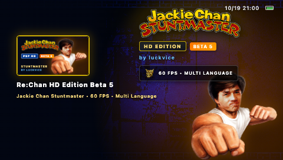
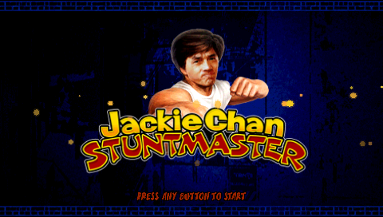
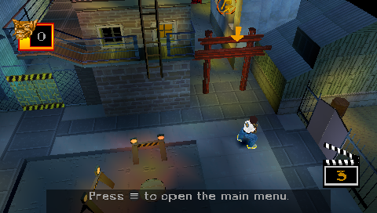
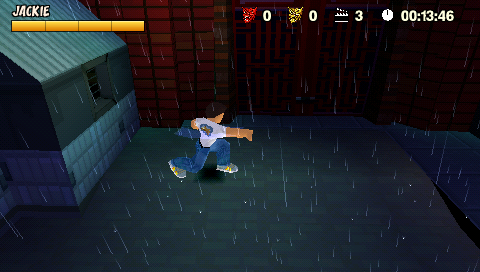

<p align="right">
  <a href="README.md">English</a> |
  <a href="README.pt-BR.md">Português (Brasil)</a> |
  <b>Español</b>
</p>

<table align="center">
<tr>
<td valign="middle">

# ReChan — Edición Mejorada y Optimizada
**Por Luckvice**

**ReChan** es una reimplementación abierta mediante ingeniería inversa del clásico de PlayStation **Jackie Chan Stuntmaster** (SLUS-00684).

Este fork desarrollado por **Luckvice** tiene como objetivo brindar una experiencia de juego definitiva, altamente optimizada y mejorada para hardware moderno y retro, introduciendo importantes mejoras de rendimiento, ports nativos dedicados para consolas, refinamientos visuales y múltiples añadidos de calidad de vida.

> [!NOTE]
> **Agradecimientos Especiales y Reconocimiento**: Nuestro más sincero agradecimiento al creador original ([SilverwireGames](https://github.com/SilverwireGames/ReChan)) y a todos los colaboradores de la base original de ingeniería inversa. El propósito de este fork es llevar a experiencia de *Jackie Chan Stuntmaster* a su más alto nivel de fidelidad y rendimiento.

> [!IMPORTANT]
> **Estado Oficial del Proyecto**: ¡Estamos oficialmente en la **Beta 5**! El trabajo actual se centra en consolidar la estabilidad, el rendimiento e el pulido general en todas las plataformas y en el motor base, preparando el camino para el lanzamiento inminente de la **RC1 (Release Candidate 1)**.

### Para utilizar este proyecto:
* **Debes poseer una copia legal** de *Jackie Chan Stuntmaster* (SLUS-00684).
* Debes proporcionar tu propia imagen de disco del juego.
* Todos los derechos del juego original, recursos y propiedad intelectual pertenecen a sus respectivos dueños.

<br>


</td>

<td align="center" valign="middle" width="256">

</td>
</tr>
</table>

## Acerca del Proyecto
* Versión objetivo: **SLUS-00684** (NTSC-U)
* Inicio del desarrollo: **Octubre de 2025**
* Estado actual: **Beta 5** (RC1 muy pronto)

El proyecto se enfoca en:
* Reconstruir la lógica y los sistemas originales del juego
* Reconstruir las estructuras de datos y replicar el comportamiento auténtico en tiempo de ejecución
* Proporcionar ports nativos ultraoptimizados para plataformas icónicas y modernas (PSP, macOS Metal, PS2 WIP)
* Elevar el rendimiento, la fidelidad visual y la calidad de audio más allá de los límites del hardware original

## Mejoras
Más allá de la reconstrucción, el proyecto introduce mejoras respecto a la versión original de PlayStation:
- Compatibilidad con teclado y ratón  
- Compatibilidad con mandos y vibración, incluyendo la **barra de luz de DualSense/DualShock 4** e intensidad de vibración configurable  
- Estilos de botones de mando seleccionables (Xbox, Nintendo Switch y **PlayStation/DualSense**)  
- Soporte para pantalla panorámica HOR+  
- Renderizado a mayores resoluciones  
- Sombras dinámicas y opciones de suavizado de contornos (anti-aliasing)  
- Ajustes y mejoras específicas para PC  
- Localización en **Español** y **Portugués de Brasil** (además de inglés, alemán, francés e italiano)  
- Compatibilidad con subtítulos en cinemáticas (`.srt`) y atajos para guardar/cargar durante la partida  
- Mejoras generales de calidad de vida  

## Capturas de Pantalla

### Edición de Escritorio
<p align="center">
  
  
  
</p>

### PSP — RE:Chan HD Edition (Nativo 480×272)
<p align="center">
  
  
  
  
</p>

## Primeros Pasos

Los datos del juego **no están incluidos**. Coloca una imagen de disco NTSC-U obtenida legalmente de tu propia copia (`.bin` o `.iso`) en una carpeta `discimage` junto al ejecutable:

```text
rechan/
|-- rechan.exe       # Windows (utiliza "rechan" en Linux y macOS)
`-- discimage/
    `-- game.bin     # o game.iso, el nombre del archivo es indiferente
```

Conserva únicamente una imagen de disco dentro de `discimage`. En el primer inicio, ReChan comprueba la versión del disco y utiliza su extractor integrado para preparar los archivos requeridos.
No se requiere ninguna utilidad de extracción externa.
Una vez extraídos los recursos, la carpeta de la imagen de disco puede eliminarse.

ReChan actualmente es compatible con Windows y Linux en x86 de 64 bits (`x86_64`) y macOS en Apple Silicon (`arm64`). En macOS, el renderizador hace uso de un backend nativo en Metal. Para compilarlo tú mismo, consulta la [guía de compilación](docs/visionmaster/business/sources/BUILDING.md). También está disponible un port nativo para PSP mediante PSPSDK. Consulta las secciones de plataforma a continuación para conocer la lista completa de características de cada edición.

## Ediciones por Plataforma

### PSP — *RE:Chan HD Edition* (Beta 5 — RC1 muy pronto)

<p align="center">
  
  
</p>
<p align="center">
  
  
</p>

Una compilación totalmente nativa para PSP (sin emulación) construida con PSPSDK, optimizada para la pantalla fija de 480×272. Se distribuye como una edición propia con funciones adicionales sobre el juego base:

- **60 FPS en PSP-2000/3000** (medición real de 58.5–60 FPS en todos los niveles), con un modo opcional **Cine** bloqueado a 30 FPS estables
- Renderizado con triple búfer y llamadas indexadas nativas (memoria de lista del GE e índices persistentes)
- **HUD Moderno** (el HUD HD de PC adaptado a 480×272) o estilo **Clásico**, seleccionable en el primer inicio
- Menús nativos adaptados a la interfaz XMB con **iconos de botones de PlayStation**
- **Tres opciones de cámara más cercana**, además de la cámara original
- **Películas FMV con subtítulos en seis idiomas** (Español, Portugués de Brasil, Inglés, Francés, Alemán e Italiano)
- Pantallas de logo de inicio, **modo de demostración** en la pantalla de título y **desfile de créditos de los colaboradores**
- **Extracción de la imagen de disco en la propia consola**: la PSP prepara los recursos directamente desde la imagen de disco del usuario, con selección de idioma y HUD en el primer inicio — sin necesidad de PC
- Menú de ajustes específico para PSP, además de modos de compilación para depuración/QA, telemetría, prueba de estrés (soak) y PRX mediante PSPLink para desarrollo
- Aprovecha la partición extendida de memoria de usuario (MEMSIZE) en PSP-2000/3000/Go, con optimizaciones especializadas de heap de baja memoria (<24 MB de partición de usuario) para compatibilidad total con **PSP-1000 (Fat)**

Requisitos: Cualquier modelo de PSP (PSP-1000 Fat, PSP-2000 Slim, PSP-3000 Brite o PSP Go) con custom firmware o HEN, imagen de disco NTSC-U (SLUS-00684) y ~1.3 GB de espacio libre durante la instalación (~600 MB tras completarla). Paquete de instalación y notas completas: `dist/psp-release/` (Beta 5).

### macOS — Edición Metal

Una compilación nativa para Apple Silicon (`arm64`) que renderiza a través de un **backend Metal dedicado** (sin capa de traducción OpenGL), con el conjunto completo de características de la versión de escritorio:

- Renderizador nativo **Metal** desarrollado sobre `pddi` (shaders compilados en tiempo de ejecución, MSAA, texturas dinámicas, capas superpuestas de ImGui)
- Todo lo incluido en [Mejoras](#mejoras): pantalla panorámica HOR+, renderizado en alta resolución, sombras dinámicas, compatibilidad con DualSense/DualShock con barra de luz, teclado y ratón, todas las localizaciones, subtítulos `.srt` en vídeos
- Mismo proceso de extracción de imágenes de disco que en Windows/Linux (carpeta `discimage/`)
- Entorno de pruebas determinista `--autotest` con captura de pantallas mediante lectura directa de Metal, utilizado para pruebas de regresión del renderizador

Para compilar, consulta la [guía de compilación](docs/visionmaster/business/sources/BUILDING.md) (`premake5 gmake2` + `make config=release`).

### PlayStation 2 — Edición Nativa GS (En Desarrollo 🚧)

Un port completamente nativo para PlayStation 2 que se ejecuta directamente en el procesador **Emotion Engine (EE)** de la consola y renderiza en el hardware **Graphics Synthesizer (GS)** mediante un backend `pddi` especializado y `gsKit`:

- **Escaneo Progresivo Nativo a 480p**: Salida progresiva nativa a $640 \times 480$ (Modo 80 a 59.94 Hz) con doble búfer.
- **Arquitectura Dedicada de VRAM a 16 bits**: Implementa framebuffers de 16 bits y modo de almacenamiento de texturas (`GS_PSM_CT16` / RGBA5551, 2 bytes/téxel), liberando ~2.12 MiB de memoria GS. Capas a pantalla completa de $640 \times 360$ para la interfaz (`background`, `jackie`, `jcslogo`), atlas de fuentes y sistemas de partículas residen simultáneamente en la VRAM con **cero saturación / cero desalojos por fotograma**.
- **Renderizado Diseñado para el Hardware**: Rasterización por función fija del GS en sustitución de los shaders programables de escritorio, con colas de primitivas texturizadas y Gouraud, mezcla alfa (alpha-blending) por hardware y colores vivos sin sobreexposición (blowout).
- **Subsistemas Nativos**: Lectura de mandos con `libpad`, inicialización de drivers IOP y transferencias de datos DMA GIF.
- **Verificación**: Probado tanto en PCSX2 como en hardware real de PlayStation 2 mediante el mapeo de sistema de archivos `host:`.

Para más detalles sobre la compilación y el desarrollo, consulta [ps2/README.md](ps2/README.md).

## Créditos y Reconocimientos

- **Creador Original del Proyecto**: Sincero agradecimiento y profundo reconocimiento a [SilverwireGames](https://github.com/SilverwireGames/ReChan) por el extraordinario trabajo original de ingeniería inversa y reconstrucción del código de *Jackie Chan Stuntmaster*.
- **Luckvice**: Creador y encargado de este fork, responsable de las ediciones optimizadas, la concepción de *RE:Chan HD Edition* para PSP, el backend nativo Metal para macOS, el port nativo para PlayStation 2 (GS), optimizaciones profundas de memoria/CPU y mejoras destinadas a ofrecer la experiencia definitiva.
- **Comunidad y Colaboradores**: A todos los aficionados, testers e investigadores que colaboran con pruebas, informes de errores, documentación y soporte para mantener vivo el legado de este clásico.

## Aviso Legal y sobre Recursos

ReChan es un proyecto no oficial, gratuito y no comercial de reimplementación de *Jackie Chan Stuntmaster*. No está afiliado, respaldado, patrocinado ni aprobado por ningún desarrollador original, distribuidor ni titular de los derechos de autor.

El paquete de lanzamiento puede incluir archivos de soporte creados específicamente para ReChan por el autor del proyecto, incluyendo nuevos archivos de texto, fuentes y texturas. Estos son archivos creados desde cero para ReChan, no son archivos del juego de PlayStation y no contienen ni redistribuyen contenido extraído o copiado del juego original.

Para evitar cualquier duda: **ningún recurso original del juego, imagen de disco, ROM, ejecutable original, vídeo, música, clip de voz, textura, modelo, nivel u otros datos protegidos por derechos de autor de PlayStation están incluidos ni se distribuyen con ReChan.**
La imagen de disco ubicada en `discimage` es suministrada por el propio usuario a partir de su copia legalmente adquirida. Sus recursos requeridos se extraen localmente en el dispositivo del usuario y no forman parte de la distribución de ReChan.

*Jackie Chan Stuntmaster* y todas las marcas registradas, derechos de autor, personajes, nombres, logotipos, recursos y datos del juego siguen siendo propiedad de sus respectivos titulares. Las bibliotecas de terceros o recursos incluidos con ReChan permanecen sujetos a sus respectivas licencias.

## Preguntas Frecuentes (FAQ)

**¿Es esto un emulador de PS1?**  
No. ReChan es una reimplementación. La lógica del juego ha sido reescrita en C++ y no emula el hardware de PS1.

**¿Funcionará con las versiones PAL?**  
Actualmente solo se tiene como objetivo la versión NTSC-U (**SLUS-00684**). La versión PAL no está soportada y puede diferir en la distribución de los datos.

**¿Tendrá soporte para el hardware original de PS1?**  
No. Ese no es un objetivo de este proyecto.

**¿Puedo colaborar?**  
Sí. Documentación, análisis de formatos de datos y comportamiento son bienvenidos. Consulta la [guía de compilación](docs/visionmaster/business/sources/BUILDING.md) para comenzar.

## Informes de Error (Crash reports)

Los cierres inesperados generan `minidumps/rechan-crash-<process-id>.txt` e invitan al usuario a abrir una incidencia en GitHub. En Windows también se crea un volcado minidump `.dmp` correspondiente en dicha carpeta. Los informes en modo depuración adjuntan `rechan.log`; las compilaciones Release omiten por completo los registros. Los informes se guardan localmente y nunca se envían de forma automática.

Los mantenedores pueden verificar el controlador de fallos con `--test-crash-reporter`. Establece `RECHAN_CRASH_REPORTER_NO_DIALOG=1` al ejecutar esta verificación en entornos de automatización.

## Registro de Cambios (Changelog)

Los cambios destacados se detallan en [CHANGELOG.md](CHANGELOG.md).

## Licencia
Licencia MIT.

Se aplica exclusivamente a este código fuente.  
No se aplica al juego original ni a sus recursos.
